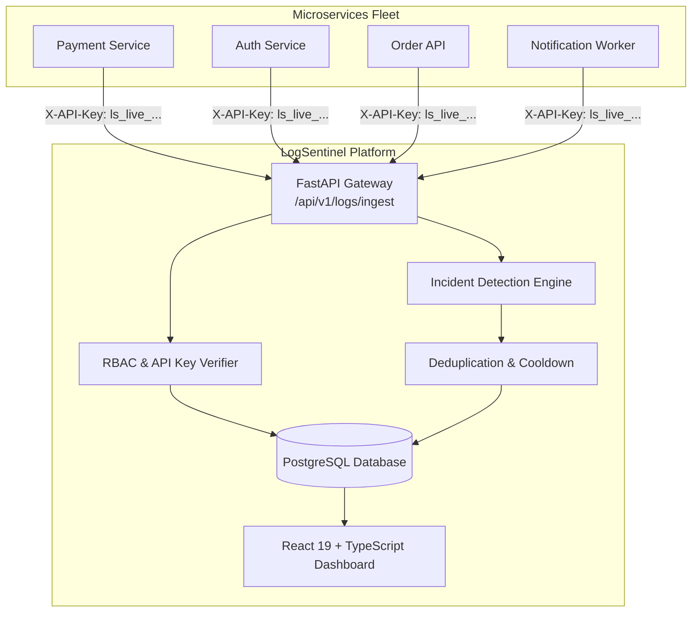

# LogSentinel — Cloud Log Intelligence & Incident Detection Platform

[](https://python.org)
[](https://fastapi.tiangolo.com)
[](https://react.dev)
[](https://www.typescriptlang.org)
[](https://www.postgresql.org)
[](https://docker.com)
[]()

> A production-grade, full-stack cloud observability and automated incident detection platform engineered to ingest, index, and analyze distributed application telemetry, evaluate real-time incident detection rules, prevent alert fatigue through deterministic fingerprint deduplication, and coordinate end-to-end incident response.

---

## 1. Problem Statement

Modern cloud organizations run dozens of distributed microservices emitting thousands of telemetry events per minute. When systems experience degradation, engineers face critical challenges:
- **Alert Fatigue**: A cascading failure causes thousands of duplicate errors to spam on-call teams.
- **Delayed Root Cause Analysis**: Logs are scattered across multiple hosts with no correlated trace context.
- **Unclear Ownership**: Services experience failures without automated tracking of which rule fired, who is investigating, or what mitigation was deployed.
- **Silent Service Failures**: Background workers or batch jobs crash without logging errors, remaining silent and unnoticed.

**LogSentinel** solves this by centralizing authenticated telemetry, running a genuine multi-algorithm incident detection engine, deduplicating recurring events into active incident lifecycles, and providing an enterprise-grade dark-mode investigation dashboard.

---

## 2. Key Features

- **Authenticated Log Ingestion**:
  - Single event (`POST /api/v1/logs/ingest`) and batch ingestion (`POST /api/v1/logs/ingest/batch`, up to 500 events).
  - Cryptographically hashed service ingestion keys (`ls_live_...`) with one-time raw display.
  - Strict service identity validation (prevents service log impersonation).
  - Request size limits, UTC timestamp normalization, and sliding-window rate limiting.
- **Genuine Rule-Based Incident Detection Engine**:
  - **Rule 1: Error Threshold**: Triggers when error/critical log count reaches threshold within a rolling window.
  - **Rule 2: Critical Log**: Instant high-priority incident creation upon encountering a `CRITICAL` severity event.
  - **Rule 3: Repeated Failure**: Grouped signature pattern detection (e.g. recurring database connection pool timeouts).
  - **Rule 4: Service Error Rate**: Calculates error proportion ($\frac{\text{errors}}{\text{total logs}}$) with minimum traffic safeguards.
  - **Rule 5: Service Inactivity**: Heartbeat evaluation detecting silent workers that stop producing logs.
- **Deterministic Deduplication & Debouncing**:
  - Stable SHA-256 fingerprinting: `SHA256(rule_id + service_id + environment + error_signature)`.
  - Aggregates recurring failures into the existing active incident, incrementing event counts and appending timeline events without creating duplicate tickets.
- **Complete Incident Lifecycle**:
  - State machine with validated transitions: `OPEN` $\to$ `ACKNOWLEDGED` $\to$ `INVESTIGATING` $\to$ `RESOLVED` $\to$ `REOPEN`.
  - Engineer assignment, investigation notes, resolution summaries, and persistent PostgreSQL audit timeline.
- **Observability Dashboard & Logs Explorer**:
  - Recharts metrics: log volume over time, severity distribution donut, incident trends, incidents per service, fleet health status.
  - Server-side indexed pagination, date range windows, trace ID search, metadata JSON viewer, and CSV export.
- **Security & RBAC**:
  - JWT token sessions, bcrypt password hashing, and role-based permissions (`Super Admin`, `Engineer`, `Viewer`).
  - Immutable security audit logs recording administrative and access events.

---

## 3. Technology Stack

| Layer | Technologies |
| :--- | :--- |
| **Frontend** | React 19, TypeScript, Vite, React Router v7, Tailwind CSS, Recharts, Lucide React |
| **Backend** | Python 3.12, FastAPI, Pydantic v2, SQLAlchemy 2.x, Alembic, Uvicorn, Pytest, HTTPX |
| **Database** | PostgreSQL 16/18 with composite indexes and relational integrity |
| **DevOps** | Docker, Docker Compose, Nginx, GitHub Actions CI Pipeline |
| **Cloud (AWS)** | Amazon RDS PostgreSQL, AWS ECS Fargate / App Runner, S3, CloudFront, Secrets Manager |

---

## 4. Architecture Diagram



---

## 5. Quick Start (Local Windows PowerShell Setup)

### Prerequisites:
- Python 3.12+
- Node.js v20+ & npm
- PostgreSQL 16/18 running locally on port 5432

### Step 1: Environment Configuration
Copy `.env.example` to `.env` and verify database credentials:
```powershell
cp .env.example .env
```

### Step 2: Run Database Migrations & Seed Data
```powershell
cd backend
python -m alembic upgrade head
python scripts/seed_data.py
```
*The seed script populates demo accounts, microservices, detection rules, and telemetry.*

### Step 3: Run Backend Server
```powershell
# Inside backend directory:
uvicorn app.main:app --reload --port 8000
```
- Interactive Swagger UI: [http://localhost:8000/docs](http://localhost:8000/docs)
- Liveness Probe: [http://localhost:8000/health/live](http://localhost:8000/health/live)
- Database Readiness Probe: [http://localhost:8000/health/ready](http://localhost:8000/health/ready)

### Step 4: Run Frontend Development Server
In a new terminal window:
```powershell
cd frontend
npm run dev
```
Open browser at **[http://localhost:5173](http://localhost:5173)**.

### Step 5: Demo Login Credentials (1-Click Buttons Available on Login Screen):
- **Super Admin**: `admin@logsentinel.local` / `AdminSecurePass123!`
- **Engineer**: `engineer@logsentinel.local` / `EngineerSecurePass123!`
- **Viewer**: `viewer@logsentinel.local` / `ViewerSecurePass123!`

---

## 6. Live Telemetry Simulation

In a separate terminal, run the included synthetic log generator to simulate real production scenarios against the running API:
```powershell
# Send 10 normal logs
python backend/scripts/log_generator.py --scenario normal --count 10

# Trigger error burst threshold rule
python backend/scripts/log_generator.py --scenario error_burst --count 10

# Trigger immediate critical severity rule
python backend/scripts/log_generator.py --scenario critical --count 1

# Trigger repeated database pool failure rule
python backend/scripts/log_generator.py --scenario repeated_failure --count 5
```
Watch the Overview Dashboard, Incidents list, and Alerts bell update in real-time!

---

## 7. Running Tests

Execute the comprehensive automated test suite:
```powershell
# Backend Pytest Suite (19 tests covering auth, rules, deduplication, lifecycle):
cd backend
python -m pytest tests -v

# Frontend TypeScript Typecheck & Production Build:
cd frontend
npm run build
```

---

## 8. Docker Compose Deployment

To run the entire platform in Docker:
```bash
docker compose up -d --build
```
- Frontend UI: `http://localhost:3000`
- Backend API: `http://localhost:8000/docs`
- PostgreSQL: `localhost:5432`

---

## 9. Placement & Technical Interview Talking Points

For final-year engineering interviews in backend, cloud, and DevOps roles, here are key architectural decisions to highlight:

1. **Why PostgreSQL instead of MongoDB or SQLite?**
   - Incidents require strict ACID transactions and relational integrity between services, rules, and triggering logs.
   - Using PostgreSQL with composite indexes on `(service_name, environment, timestamp)` enables fast bounded queries across millions of log records.
   - In-memory SQLite lacks concurrent database row locking (`with_for_update()`) used for race-condition-free incident deduplication.
2. **How does Deduplication prevent Alert Fatigue?**
   - Instead of raising a new ticket for every repeated error, LogSentinel computes a deterministic SHA-256 fingerprint from the rule, service, environment, and error signature.
   - If an active incident exists, it atomically updates `last_detected_at`, increments `event_count`, links the new logs, and logs a timeline event, protecting the on-call engineer from alert floods.
3. **Security Architecture**:
   - Ingestion API keys are never stored in plaintext; only the SHA-256 cryptographic hash and key prefix are persisted.
   - API endpoints enforce Role-Based Access Control (RBAC) at the route level via FastAPI dependency injection, not merely frontend button toggles.

---

## 10. Documentation Index

- [Architecture & System Design](docs/architecture.md)
- [Database Schema & Models](docs/database-schema.md)
- [REST API Reference](docs/api.md)
- [Security & Access Control](docs/security.md)
- [Testing & Quality Verification](docs/testing.md)
- [Cloud & Local Deployment Guide](docs/deployment.md)

---

## License
MIT License. Developed for technical placements and cloud observability portfolios.
