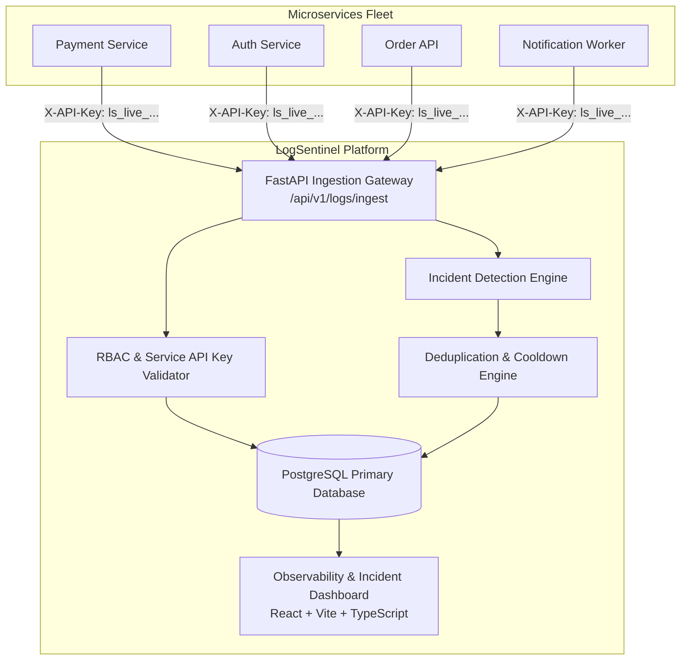

# LogSentinel — System Architecture & Design

## 1. Architectural Overview

LogSentinel is an enterprise-grade cloud log intelligence and automated incident detection platform engineered as a modular monolith. It centralizes distributed application telemetry, performs real-time rule-based anomaly detection, deduplicates recurring failures, and manages the complete incident response lifecycle.

---

## 2. Telemetry Ingestion Pipeline

1. **Authentication**: Incoming requests contain an `X-API-Key` header with format `ls_live_<token>`. The system hashes the token with SHA-256 and validates it against active `service_ingestion_keys`.
2. **Validation & Normalization**:
   - Message payloads are limited to 32 KB.
   - Metadata JSON payloads are limited to 64 KB.
   - Timestamps are normalized to UTC timezone.
   - Service identity is strictly verified (a service key cannot emit logs under another service identity).
3. **Storage & Indexing**: Accepted events are persisted into the `logs` table with composite indexes on `(service_name, environment, timestamp)` and `(severity, timestamp)`.

---

## 3. Incident Detection Engine Architecture

The detection engine executes in the database transaction immediately following log acceptance:

1. **Rule Evaluation**:
   - **Error Threshold**: Counts `ERROR` and `CRITICAL` logs for the service in the rolling window ($t_{window}$). If $\text{count} \ge \text{threshold}$, triggers incident.
   - **Critical Log**: Evaluates single-event severity. If `severity == CRITICAL`, triggers immediately.
   - **Repeated Failure**: Filters logs matching a specific error pattern or signature. If repeated $\ge \text{threshold}$ times, triggers incident.
   - **Service Error Rate**: Calculates $\frac{\text{error logs}}{\text{total logs}}$ over the window. Enforces a minimum of 5 total logs to avoid small-sample false positives.
   - **Service Inactivity**: Monitors whether active non-disabled services have stopped sending telemetry past the configured silence duration.
2. **Deterministic Deduplication**:
   - A deterministic SHA-256 fingerprint is calculated:
     $$\text{Fingerprint} = \text{SHA256}(\text{rule\_id} + \text{service\_id} + \text{environment} + \text{error\_signature})$$
   - If an incident with the same fingerprint is in an active status (`OPEN`, `ACKNOWLEDGED`, `INVESTIGATING`):
     - The existing incident's `last_detected_at` is updated.
     - `event_count` is incremented.
     - New triggering logs are linked via `incident_logs`.
     - A `REPEATED` timeline event is logged.
     - **No duplicate active incident is created.**
   - If no active incident exists:
     - A new `Incident` is created with status `OPEN`.
     - An in-app `Alert` record is generated.
     - A `CREATED` timeline event is appended.
