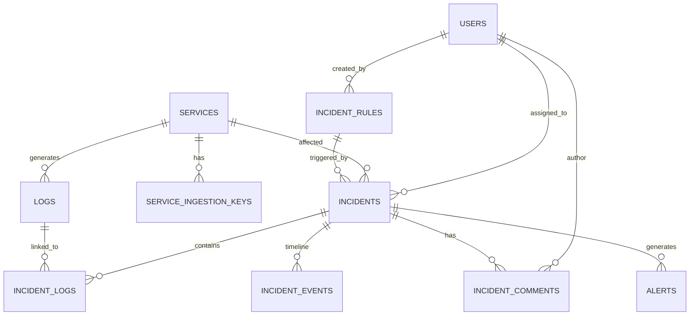

# LogSentinel — Database Schema Specification

## 1. Relational Entity Diagram

---

## 2. Table Definitions

### 1. `users`
- `id` (VARCHAR(36), PK): UUID identifier
- `email` (VARCHAR(255), UNIQUE, INDEX): User email
- `hashed_password` (VARCHAR(255)): Bcrypt password hash
- `full_name` (VARCHAR(255)): User full name
- `role` (VARCHAR(50)): `super_admin`, `engineer`, `viewer`
- `is_active` (BOOLEAN): Account active state
- `created_at`, `updated_at` (TIMESTAMP WITH TIME ZONE)

### 2. `services`
- `id` (VARCHAR(36), PK): UUID identifier
- `name` (VARCHAR(100), INDEX): Service identifier
- `description` (TEXT): Service documentation
- `environment` (VARCHAR(50)): `development`, `testing`, `staging`, `production`
- `owner_team` (VARCHAR(100)): Responsible squad
- `is_enabled` (BOOLEAN): Ingestion status
- `created_at`, `updated_at` (TIMESTAMP WITH TIME ZONE)
- `last_log_at` (TIMESTAMP WITH TIME ZONE, NULLABLE): Heartbeat timestamp
- **Constraints**: `UNIQUE(name, environment)`

### 3. `service_ingestion_keys`
- `id` (VARCHAR(36), PK): UUID identifier
- `service_id` (VARCHAR(36), FK `services.id`, ON DELETE CASCADE)
- `key_name` (VARCHAR(100)): Label for key
- `key_prefix` (VARCHAR(32)): Plaintext prefix (`ls_live_...`)
- `key_hash` (VARCHAR(255)): SHA-256 hash of secret
- `is_revoked` (BOOLEAN): Revocation flag
- `created_at`, `last_used_at` (TIMESTAMP WITH TIME ZONE)

### 4. `logs`
- `id` (VARCHAR(36), PK): UUID identifier
- `service_id` (VARCHAR(36), FK `services.id`, ON DELETE CASCADE)
- `service_name` (VARCHAR(100), INDEX)
- `environment` (VARCHAR(50), INDEX)
- `severity` (VARCHAR(20), INDEX): `DEBUG`, `INFO`, `WARNING`, `ERROR`, `CRITICAL`
- `message` (TEXT): Log message payload
- `timestamp` (TIMESTAMP WITH TIME ZONE, INDEX)
- `source` (VARCHAR(100))
- `trace_id` (VARCHAR(100), INDEX)
- `metadata_json` (JSON): Structured metadata
- `created_at` (TIMESTAMP WITH TIME ZONE)
- **Indexes**:
  - `ix_logs_service_env_timestamp` on `(service_name, environment, timestamp)`
  - `ix_logs_severity_timestamp` on `(severity, timestamp)`

### 5. `incident_rules`
- `id` (VARCHAR(36), PK): UUID identifier
- `name` (VARCHAR(150), UNIQUE, INDEX)
- `description` (TEXT)
- `rule_type` (VARCHAR(50), INDEX): `error_threshold`, `critical_log`, `repeated_failure`, `error_rate`, `service_inactivity`
- `severity` (VARCHAR(20)): `LOW`, `MEDIUM`, `HIGH`, `CRITICAL`
- `service_id` (VARCHAR(36), FK `services.id`, NULLABLE)
- `environment` (VARCHAR(50), NULLABLE)
- `threshold` (FLOAT)
- `time_window_seconds` (INT): Rolling window
- `cooldown_seconds` (INT): Alert debouncing
- `error_signature_pattern` (VARCHAR(255), NULLABLE)
- `is_enabled` (BOOLEAN, INDEX)
- `created_by_id` (VARCHAR(36), FK `users.id`, NULLABLE)
- `created_at`, `updated_at` (TIMESTAMP WITH TIME ZONE)

### 6. `incidents`
- `id` (VARCHAR(36), PK): UUID identifier
- `title` (VARCHAR(255))
- `description` (TEXT)
- `severity` (VARCHAR(20), INDEX): `LOW`, `MEDIUM`, `HIGH`, `CRITICAL`
- `status` (VARCHAR(20), INDEX): `OPEN`, `ACKNOWLEDGED`, `INVESTIGATING`, `RESOLVED`
- `service_id` (VARCHAR(36), FK `services.id`, ON DELETE CASCADE)
- `environment` (VARCHAR(50), INDEX)
- `rule_id` (VARCHAR(36), FK `incident_rules.id`, NULLABLE)
- `fingerprint` (VARCHAR(255), INDEX): Deduplication key
- `error_signature` (VARCHAR(255))
- `first_detected_at`, `last_detected_at` (TIMESTAMP WITH TIME ZONE)
- `acknowledged_at`, `resolved_at` (TIMESTAMP WITH TIME ZONE, NULLABLE)
- `assigned_user_id` (VARCHAR(36), FK `users.id`, NULLABLE)
- `event_count` (INT): Total logs aggregated
- `created_at`, `updated_at` (TIMESTAMP WITH TIME ZONE)

### 7. `incident_logs`
- `id` (VARCHAR(36), PK)
- `incident_id` (VARCHAR(36), FK `incidents.id`, ON DELETE CASCADE)
- `log_id` (VARCHAR(36), FK `logs.id`, ON DELETE CASCADE)
- `created_at` (TIMESTAMP WITH TIME ZONE)

### 8. `incident_comments`
- `id` (VARCHAR(36), PK)
- `incident_id` (VARCHAR(36), FK `incidents.id`, ON DELETE CASCADE)
- `user_id` (VARCHAR(36), FK `users.id`, ON DELETE CASCADE)
- `comment` (TEXT)
- `created_at` (TIMESTAMP WITH TIME ZONE)

### 9. `incident_events`
- `id` (VARCHAR(36), PK)
- `incident_id` (VARCHAR(36), FK `incidents.id`, ON DELETE CASCADE)
- `event_type` (VARCHAR(50)): `CREATED`, `ACKNOWLEDGED`, `INVESTIGATING`, `RESOLVED`, `REOPENED`, `ASSIGNED`, `COMMENTED`, `REPEATED`
- `actor_id` (VARCHAR(36), FK `users.id`, NULLABLE)
- `actor_name` (VARCHAR(100))
- `details_json` (JSON)
- `created_at` (TIMESTAMP WITH TIME ZONE)

### 10. `alerts`
- `id` (VARCHAR(36), PK)
- `incident_id` (VARCHAR(36), FK `incidents.id`, ON DELETE CASCADE)
- `title` (VARCHAR(255))
- `message` (TEXT)
- `severity` (VARCHAR(20))
- `is_read` (BOOLEAN, INDEX)
- `created_at` (TIMESTAMP WITH TIME ZONE, INDEX)

### 11. `audit_logs`
- `id` (VARCHAR(36), PK)
- `actor_email` (VARCHAR(255), INDEX)
- `actor_role` (VARCHAR(50))
- `action` (VARCHAR(100), INDEX)
- `target_type` (VARCHAR(50))
- `target_id` (VARCHAR(100), NULLABLE)
- `correlation_id` (VARCHAR(100), NULLABLE)
- `details_json` (JSON)
- `ip_address` (VARCHAR(50), NULLABLE)
- `created_at` (TIMESTAMP WITH TIME ZONE, INDEX)
