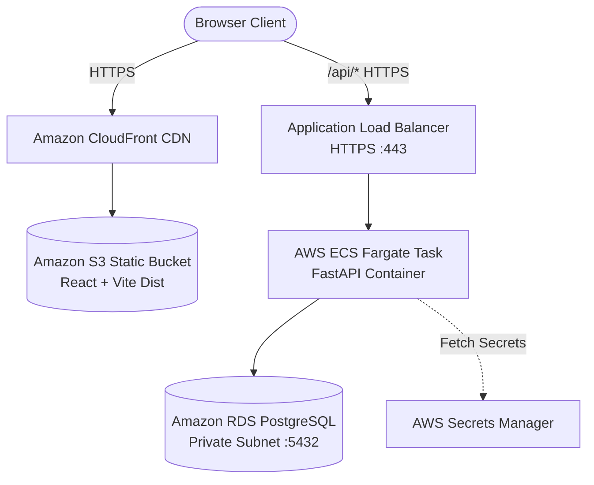

# LogSentinel — Cloud & Local Deployment Guide

## 1. AWS Cloud Production Architecture



### AWS Component Matrix

1. **Frontend Hosting**:
   - Built assets (`frontend/dist/`) hosted in an Amazon S3 bucket configured for static web hosting.
   - Distributed globally with Amazon CloudFront with SSL certificate via AWS Certificate Manager (ACM).
2. **Backend API Compute**:
   - Containerized FastAPI application running on **AWS ECS with AWS Fargate** or **AWS App Runner**.
   - Autoscaling policies based on CPU utilization and request count.
3. **Primary Database**:
   - **Amazon RDS for PostgreSQL** (e.g. `db.t4g.medium` or higher for production workloads).
   - Deployed into private subnets across multiple Availability Zones (Multi-AZ).
   - Automated daily snapshots and point-in-time recovery (PITR) enabled.
4. **Security & Secrets**:
   - Database credentials and `SECRET_KEY` stored securely in **AWS Secrets Manager**.
   - AWS IAM Execution Roles with least-privilege policies.
   - Security Groups allowing inbound traffic to RDS strictly from the ECS task security group on port 5432.

---

## 2. Docker Compose Deployment (Local or Single-Instance EC2)

LogSentinel includes a complete `docker-compose.yml` orchestrating PostgreSQL, FastAPI backend, and React frontend with Nginx.

```bash
# 1. Start all services in background
docker compose up -d --build

# 2. View logs
docker compose logs -f backend

# 3. Access applications:
# Frontend: http://localhost:3000
# Backend API & Docs: http://localhost:8000/docs
# PostgreSQL Database: localhost:5432
```

---

## 3. Local Development Setup (Windows PowerShell Native)

If Docker is not installed on the developer workstation, run directly with Python and Node:

### 1. Database & Migrations:
```powershell
# In backend directory:
python -m alembic upgrade head
python scripts/seed_data.py
```

### 2. Start Backend Server:
```powershell
# In backend directory:
uvicorn app.main:app --reload --port 8001
```
Backend API interactive Swagger UI: `http://localhost:8001/docs`

### 3. Start Frontend Development Server:
```powershell
# In frontend directory:
npm run dev
```
Open browser: `http://localhost:5174`

All `/api` requests are automatically proxied to `http://localhost:8001` (configured via `frontend/.env` / `vite.config.ts`).


---

## 4. Demonstrating the Platform with Live Logs

In a separate terminal, run the synthetic log generator to stream live scenarios:
```powershell
# Normal traffic:
python scripts/log_generator.py --scenario normal --count 10

# Trigger error burst threshold rule:
python scripts/log_generator.py --scenario error_burst --count 10

# Trigger immediate critical severity rule:
python scripts/log_generator.py --scenario critical --count 1

# Trigger repeated failure database rule:
python scripts/log_generator.py --scenario repeated_failure --count 5
```
Watch the Overview Dashboard and Incidents page update in real time!
